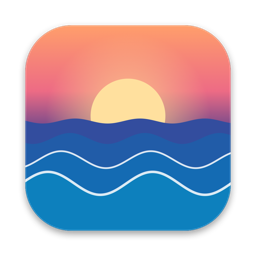
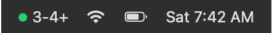
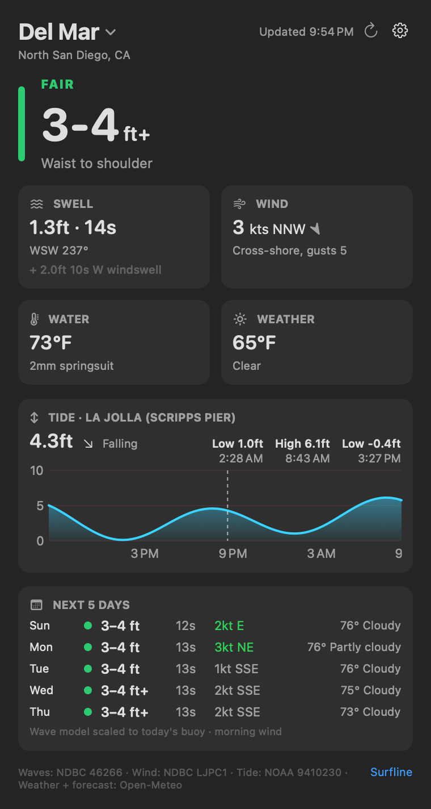
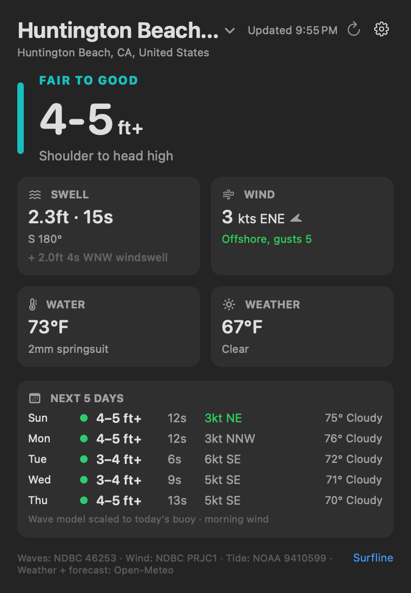
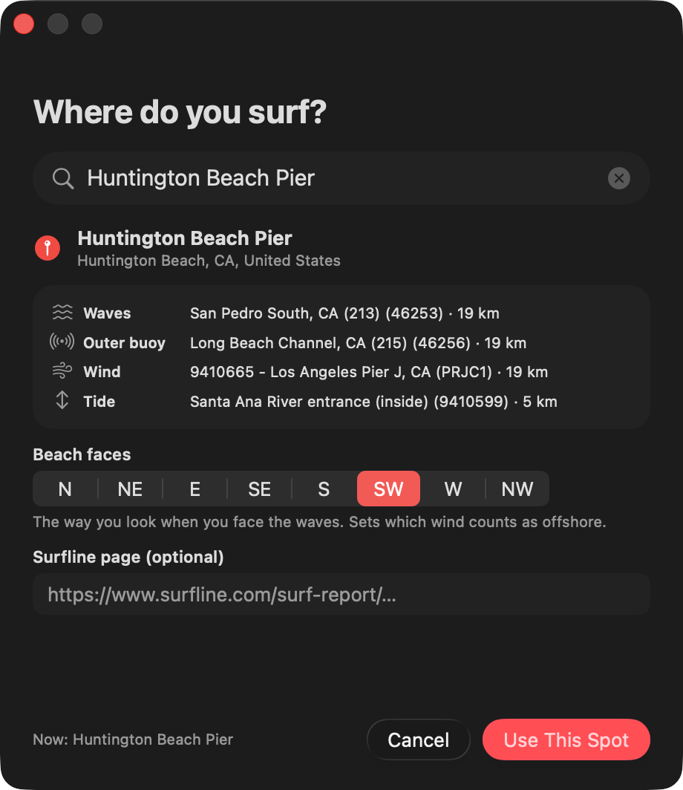
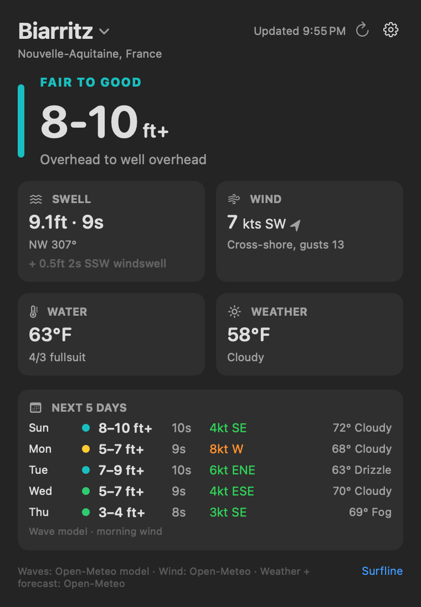

<p align="center"></p>

<h1 align="center">Swellbar</h1>

<p align="center">The surf report for your beach, in the Mac menu bar.</p>

<p align="center"></p>

Swellbar puts the current surf height in your menu bar (`● 3-4+`), with the dot colored by
how good it is. Click it for swell, wind, water temperature, weather, a tide chart and a
five-day forecast. It works for any beach: search for yours and Swellbar finds the nearest buoys and
stations on its own. No account, no API keys, free public data.

<p align="center">
  
  &nbsp;
  
</p>

## Five-day forecast

Under the tide chart, **Next 5 Days** shows each day's surf, swell period, morning wind
(green when it's offshore, orange when it's onshore), the high temperature and the sky. The
surf comes from the Open-Meteo wave model. Where there's a buoy, the forecast is scaled so it
lines up with what the buoy says right now.

## Pick your spot

The first time Swellbar opens, it asks where you surf. To change it later, click the spot
name at the top of the report, or the gear > **Change Spot…**.

1. Type a beach or town (or coordinates like `21.66, -158.05`) and press Return.
2. Swellbar finds the nearest wave buoy, outer buoy, wind station and tide station, and
   shows how far away each one is.
3. Check **Beach faces**: the way you look when you face the waves. Swellbar guesses it from
   where the nearest buoy is. It decides which wind counts as offshore.
4. Optionally paste the spot's Surfline page, so the **Surfline** link opens it.
5. Click **Use This Spot**.

<p align="center"></p>

### Outside the US

NOAA buoys and tide predictions mostly cover the US. Anywhere else, Swellbar uses the
[Open-Meteo](https://open-meteo.com) wave model for waves and its forecast for wind, and
hides the tide card. Model waves are for open water just offshore, so they can read bigger
than what breaks on the beach.

<p align="center"></p>

## Install

### Download

1. Download **Swellbar.zip** from the [latest release](https://github.com/Jamesborlands/swellbar/releases/latest) and unzip it.
2. Drag **Swellbar.app** into **Applications**.
3. The app isn't notarized by Apple, so the first time, **right-click it > Open > Open**.
   If macOS says it's damaged, run this in Terminal once, then open it again:

   ```sh
   xattr -dr com.apple.quarantine /Applications/Swellbar.app
   ```

Swellbar adds itself to Login Items on first launch. Turn that off in the gear menu.

### Build from source

You need macOS 14 or later and Xcode or the Command Line Tools (`xcode-select --install`).

```sh
git clone https://github.com/Jamesborlands/swellbar.git
cd swellbar
./build.sh --install   # builds a universal app, copies it to /Applications and opens it
```

`./build.sh` alone just builds `build/Swellbar.app`, and `./build.sh --zip` also makes
`build/Swellbar.zip`.

### Don't see it in the menu bar?

- On a MacBook with a notch, a crowded menu bar hides the extra icons behind the notch.
  Hold **⌘** and drag other icons off the menu bar to make room.
- On macOS 26, check **System Settings > Menu Bar > Allow in the Menu Bar**, and make sure
  Swellbar is on.

## How it works

Data refreshes every 10 minutes, when your Mac wakes, and when you open the report.

| What | Source |
| --- | --- |
| Surf height | Nearest [NDBC](https://www.ndbc.noaa.gov) wave buoy, turned into a breaking height (Komar–Gaughan, scaled to match Surfline) |
| Swell and windswell | The buoy's spectral summary |
| Outer buoy | The next nearest wave buoy |
| Wind | Nearest NDBC weather station, else the Open-Meteo forecast |
| Tide | Nearest [NOAA tide station](https://tidesandcurrents.noaa.gov) (US) |
| Weather | [Open-Meteo](https://open-meteo.com) hourly forecast |
| No buoy nearby | [Open-Meteo Marine](https://open-meteo.com/en/docs/marine-weather-api) wave model |

The rating (POOR, FAIR, GOOD...) is Swellbar's own estimate from size, period and wind, not
Surfline's forecaster call. The height scaling (`Surf.calibration` in
`Sources/SurfMath.swift`) was tuned at Del Mar, California. If your beach reads
consistently high or low next to Surfline, adjust that one number and rebuild.

## Project layout

| File | What it does |
| --- | --- |
| `Sources/App.swift` | Menu bar item, popover, spot window, Surfline window |
| `Sources/Spot.swift` | Saved spot, place search, nearest-station finder |
| `Sources/SpotPicker.swift` | The "Where do you surf?" window |
| `Sources/SurfData.swift` | Fetches and parses buoys, tides and Open-Meteo |
| `Sources/SurfMath.swift` | Breaking height, ratings, wind direction, wetsuit |
| `Sources/SurfPopover.swift` | The report |
| `scripts/make_icon.swift` | Draws the app icon |

The README screenshots are rendered by the app itself from live data:

```sh
scripts/snapshots.sh
```

Don't run `build/Swellbar.app/Contents/MacOS/Swellbar` straight from a terminal: macOS then files
Swellbar's menu bar icon under the terminal app, and hides it whenever that app is off in
System Settings > Menu Bar. Launch it with `open` (the script does).

## License

MIT. See [LICENSE](LICENSE). Not affiliated with Surfline, NOAA or Open-Meteo.
